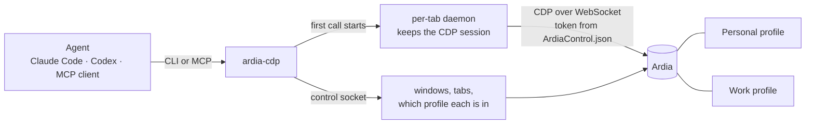
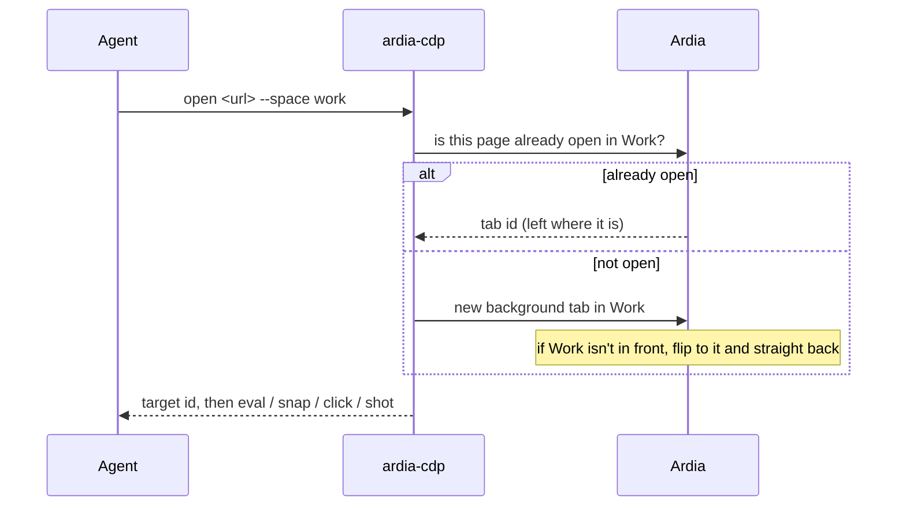
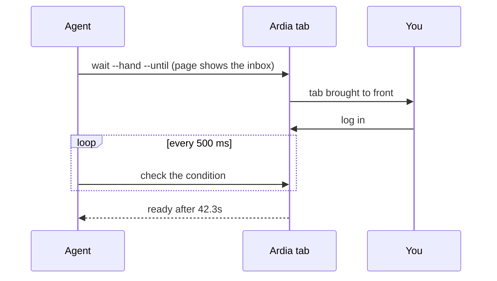

# ardia-cdp

**Let a coding agent (Claude Code, Codex, Cursor, any MCP client) drive the [Ardia](https://github.com/mantrakp04/ardia) browser: in the right profile, without duplicate tabs, and without moving the page you're on.**

| | |
|---|---|
| Dependencies | **0** (plain Node 22+, no Puppeteer or Playwright) |
| Size | **~2.4k lines** across 7 scripts (tests not counted) |
| Commands | **17** CLI commands, **9** MCP tools |
| Speed | first command **~410 ms**, then **~120 ms** per command once its daemon holds the tab |
| Tests | **59** across 4 suites |
| Setup | **1** Ardia setting. No launch flags, no launch agents |

<sub>Timings measured on macOS with Ardia 0.2.47: `eval document.title` on an open tab, median of 5 warm runs.</sub>

## How it works



CDP sees every profile's tabs as one flat list. `ardia-cdp` asks Ardia's control socket which profile each tab belongs to, so `--space work` lands in Work, with Work's logins.

### Quiet open



The tab you're reading never changes. Pass `--foreground` when you do want to see the page.

## Install

```bash
git clone https://github.com/immathanr/ardia-cdp.git
cd ardia-cdp && ./install.sh        # copies the skill to ~/.claude/skills/ardia; never overwrites
```

Then in Ardia: **Settings › Advanced › Let the ardia command control Ardia** → on.

## Use

```bash
node scripts/ardia-cdp.mjs list                                  # tabs, by profile
node scripts/ardia-cdp.mjs open https://example.com --space work # reuse, or open quietly in Work
node scripts/ardia-cdp.mjs snap  <target>                        # accessibility tree
node scripts/ardia-cdp.mjs eval  <target> "document.title"
node scripts/ardia-cdp.mjs click <target> "button.submit"
node scripts/ardia-cdp.mjs shot  <target> shot.png
node scripts/ardia-cdp.mjs stop  [target]                        # end the daemon when done
```

`<target>` is a unique prefix of an id from `list` or `open`. Run `node scripts/ardia-cdp.mjs` for all 17 commands (`nav`, `net`, `html`, `type`, `clickxy`, `loadall`, `evalraw`, `tabs`, `wait`…).

- **Claude Code:** after `install.sh`, use **`/ardia`** ("check the dashboard in my Work profile").
- **Any MCP client:** `claude mcp add ardia -- node ~/.claude/skills/ardia/scripts/mcp-server.mjs`, or point your client at `scripts/mcp-server.mjs` (stdio). Tools: `open_page`, `list_tabs`, `read_page`, `evaluate`, `navigate`, `click`, `type_text`, `screenshot`, `wait_for`.

### Hand a tab to the user

For a login, a 2FA code or a payment, the agent waits in the background until the page says you're done:



```bash
node scripts/ardia-cdp.mjs wait <target> --hand --until "location.pathname !== '/login'" --timeout 300
```

Exit `0` means ready; `1` means it timed out, and it prints the last value it saw.

### A tab, live, in a terminal pane

```bash
node scripts/ardia-pane.mjs <url> --space work --split
```

Shows one tab inside a tmux pane (Ghostty, kitty graphics), even while it's behind other tabs. Clicks, scrolls and keys go to the page. It streams live frames via ScreenCaptureKit, or about 5 screenshots a second for a background tab.

## What Ardia won't allow

On the token path, Ardia's policy refuses cookies, emulation (viewport, user agent, geolocation), file uploads, download behaviour, tracing and screencast. `ardia-cdp` doesn't work around that.

## Configuration

| Env var | Default | |
|---|---|---|
| `ARDIA_CDP_PORT` | discovered | pin a plain port (scratch instances only) |
| `ARDIA_CDP_HOST` | `127.0.0.1` | |
| `ARDIA_DATA_DIR` | the app's | a scratch Ardia's data folder |
| `ARDIA_PANE_LIVE` | `1` | `0` = pane uses screenshots only |

## Tests

```bash
node scripts/test_ardia_spaces.mjs        # 18: profiles, quiet open, handoff
node --test scripts/test_mcp_server.mjs   # 10: MCP protocol and tools
node scripts/test_pane_render.mjs         # 14: pane drawing and input
python3 scripts/test_jev_browse.py        # 17: goal-driven browsing helper
```

## Security

The endpoint listens on loopback only, behind a token Ardia generates. Like Chrome's debugging port, anything already running as your user can use it, so turn the setting off when you don't need it. This repo reads the token at runtime and never stores it.

## License

MIT © immathanr. `ardia-cdp.mjs` is ported from [arc-cdp](https://github.com/immathanr/arc-cdp), which is adapted from [pasky/chrome-cdp-skill](https://github.com/pasky/chrome-cdp-skill) (MIT © pasky). Notices are in [LICENSE](LICENSE). `./uninstall.sh` removes the skill and leaves Ardia untouched.
